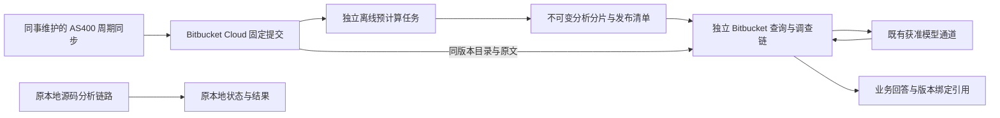

# Bitbucket 在线源码业务分析：架构设计与可行性

日期：2026-11-07。状态：**独立资料、发布、问答与工作台代码已实现并做合成验证；真实企业部署与生产验收待公司网络执行。**

已确定的研发边界是：后续聚焦 Bitbucket Cloud 源码业务分析，现有本地源码分析链路冻结。采用“周期统一预计算、在线保存版本化分析资料、工作台按问题读取资料与源码证据”。用户已授权持续实施，新代码和公司环境操作见[在线工作台使用与部署](./20-bitbucket-online-workbench.md)。已提供未启用的流水线模板；未运行真实企业源码、真实模型、云端任务或构建发布。仓库外网不可达是公司现有访问条件，本次不新增网络限制。边界决策见 [ADR-0017](./adr/0017-bitbucket-first-with-local-analysis-frozen.md)。

## 1. 核心判断与适用条件

**不新增常驻服务器具有技术可行性；几 GB 真实源码的性能、资料分发成本和现有问答引擎复用程度仍待验证。** 现有离线索引器可以作为预计算基础，但当前 SQLite 产物和问答入口不能原样搬到云端后直接使用。

用户已确认：源码位于 `bitbucket.org`，由同事负责从 AS400 每周同步一次；用户无需也无法提供同步机器、操作系统或脚本细节。系统以 Bitbucket 中已经可见的固定提交为输入，独立执行分析任务，不依赖改造同步流程或取得同步完成凭据。系统用于业务分析，希望避免每台用户电脑下载完整源码库，也不购买新的常驻服务器。本设计不改变 AS400 的导出行为，不开发源码修改、编译部署或生产执行功能。

目标是用户在没有完整本机源码目录、没有整库本机建索引的情况下，调查业务问题、沿程序及 COPY 关系补查，并引用固定版本的原文。必要的目录、关系、索引分片与原文仍会传输到分析进程和既有获准模型；不承诺零传输或任何源码字节都不离开 Bitbucket。缓存范围需要可见，不能以下载整份含原文数据库来冒充免整库下载。

全系统影响分析仍可能读取大量关系与证据。取消的是“首次接入必须先完整下载和解析”的前置条件，不保证所有问题只读少量文件，也不以减少读取量替代业务完整性。

## 2. 当前事实与主要缺口

设计检查基线：`b49173b0065386658c3ba253a9c887989f403cb6`，当时工作树干净。实施开始时另有本地分析修复工作，独立保留，不归入本次在线改造。以下是既有代码证据，不代表云端部署已经验收。

| 方面 | 当前实现与证据 | 设计影响 |
| --- | --- | --- |
| 离线预计算 | [analyze_source.py](../poc/analyze_source.py) 的 CLI 支持不带问题和模型授权的业务索引，默认静态路径使用 Python、SQLite/FTS5 | 可以在独立批处理环境调用；Linux runner、编码和大库资源仍须验证 |
| 远程接入 | [remote_source.py](../poc/remote_source.py) 首次下载 ZIP；[web_app.py](../poc/web_app.py) 建本机 source/analysis 后进入原分析器 | 当前是本机快照接入，不是在线资料查询 |
| 远程更新 | [remote_incremental.py](../poc/remote_incremental.py) 已有固定 commit 的目录、差异、文件读取与散列核验 | 可参考接口经验；新快照仍建新本机索引，不能宣称索引已跨版本增量化 |
| 机器身份 | [business_index.py](../poc/business_index.py) 检查根路径散列、解析器和读取配置；恢复流程要求本机路径有效 | 新资料身份不能依赖 runner 绝对路径，不能改路径字符串绕过核验 |
| 索引内容 | [repository_discovery.py](../poc/repository_discovery.py) 保存原文页和全文索引；[source_reading.py](../poc/source_reading.py) 可从 SQLite 读取原文 | 整份索引可能大于源码，不可假设下载索引天然更轻 |
| 问答耦合 | [business_chat.py](../poc/business_chat.py) 公共入口构造本地 QuestionSourceSession；[source_session.py](../poc/source_session.py) 校验并回读本机文件 | 不能只换下载函数，远程调查、检索和证据读取需要独立链路 |
| 复用接缝 | [procedure_expansion.py](../poc/procedure_expansion.py) 支持显式来源 provider；部分解析、模型传输、格式化可独立调用 | 复用未经修改的既有能力；内部私有函数不是已经稳定的远程接口 |

历史合成测试中，20,492 文件、约 33.7 MB 源码的本机首次导入为 54.90 秒，同语料另一项索引记录约 553 MB 数据库。它证明文件数量与索引放大需要分别考察，不代表几 GB 企业源码的耗时或固定放大倍数。见[报告](./reports/2026-10-20-framework-scale/README.md)和[原始统计](./reports/2026-10-20-framework-scale/scale-results-final-v3.json)。

## 3. 本地分析冻结边界

冻结意味着**本地调用链、数据含义和用户行为保持不变**，不只是保留入口按钮；也不表示现有本地能力无缺陷或已通过正式验收。

| 边界 | 允许 | 不允许 |
| --- | --- | --- |
| 本地接入与更新 | 用原回归验证未受影响 | 改路径选择、读取选项、默认行为及全量/增量索引流程 |
| 本地分析核心 | 在独立批处理或新模块中原样调用 CLI/公开函数 | 为远程需求重构 `analyze_source`、`business_index`、`indexed_chat`、`repository_discovery`、`source_session`、`source_reading`、`business_chat`、`semantic_scope` 等核心，或改变 schema、默认值及覆盖含义 |
| 本地对话与证据 | 按原方式保留和打开 | 迁移、重写或借用本地状态、历史、引用、框架设置和缓存作为新远程状态 |
| 共享 HTTP/页面外壳 | 未来增加显式 Bitbucket 专属分流，经过原鉴权后委派独立 controller | 重写共用生命周期和所有请求协议；改变本地接入、恢复、取消、重试、引用、导出及界面默认状态 |
| 新能力 | 新增独立远程模块、状态、缓存与测试 | 将新功能默认套到本地来源；修改或删除本地回归以迁就新实现 |

远程入口必须贯穿接入、提问、补读、取消、恢复、引用和导出，不能接入分流后又回到要求完整本机源码的 handler。共用文件只允许可审查的 Bitbucket 专属接线，本地分支与公共默认值不动。

若验证发现必须修改本地核心才能继续，应记录具体耦合和替代方案，停下该项依赖改动，由用户另行决定是否调整冻结范围。不得以抽取通用层或顺带修复为由扩大范围。旧本地入口及旧 Bitbucket 本机快照入口继续保留，不自动迁移、覆盖或删除其数据；旧远程快照不自动成为新在线模式。

## 4. 推荐架构与执行分工

### 4.1 预计算

首选验证独立的 Bitbucket Cloud Pipelines 索引任务：选定仓库提交后离线调用现有索引器，再由新增导出器生成在线资料。它是批处理任务，不运行常驻问答服务，不构建桌面 app，不执行被分析的业务源码，也不在预计算时调用模型。平台支持手动、自定义和定时触发；定时任务在指定分支的最新提交上运行，该分支须已有流水线定义 [S1]。任务固定自己的 `BITBUCKET_COMMIT`，不需要同步脚本传入完成凭据。

托管 runner 是否获准读取仓库和发布资料，仍取决于公司套餐、权限和现有网络条件；源码已托管不代表索引任务已启用。若不适用，可选公司已有的获准批处理环境。未来若同步方主动提供可复用的环境，可在那里执行同一任务减少传输，但这只是优化选项，不是当前架构依赖，也不要求用户了解同事的机器。

固定提交证明本次分析的版本一致，不能证明该提交已包含本周全部上游导出。仓库快照模式明确保存 `sync_completeness: not_verified`；如果一次同步有多次 push，定时任务可能选到中间提交。新资料通过内容核验后作为可选版本，由用户明确采用；旧版本和对话继续保留。只有同步方实际提供完成声明时，才单独记录该声明。

先建立完整离线构建基线，再评估构建增量。内容相同的分片能复用上传，不等于索引计算已经增量。现有解析器受根路径身份约束，旧数据库跨 runner 复用、COPY 影响更新都必须单独验证，不修改本地实现来实现云端增量。

### 4.2 查询

Bitbucket/资料存储只提供文件，不替工作台执行 SQL、全文排名或任意图遍历。新客户端查询层读取清单和分片路由，定位词项、程序及字段，取得必要的倒排和关系分片，再执行合并、遍历与证据组织。

原生代码搜索或已有 Code Context 可增强候选发现，但不能是唯一索引。目标资料需提供固定版本的程序名、字段、COPY 和词项目录，覆盖大文件及非默认分支。Cloud 原生搜索当前仅覆盖默认分支和小于 512 KB 的文件 [S5]；Code Context 的租户资格、额度、版本可核对性和 COBOL 检索质量尚未确认 [S8]。

自由业务问题如何找到第一批分片，是独立验证项；内容寻址本身不提供语义检索。若常见问题必须读取几乎所有分片，应如实记录成本并重新评估，不能宣称静态文件托管已经提供在线查询服务。

### 4.3 原文与本机缓存

本机保存远程来源登记、选定资料修订、所需分片、问题证据和远程对话；不建立完整本地源码工作区，也不触发旧全库索引流程。断网时只说明实际缓存范围。可重新获取的缓存与旧对话仍引用的证据分别管理，淘汰不能静默使引用失效。

按问题补取源码与 COPYBOOK，通过固定 commit/path 读取原文 [S4]。不假设文件接口支持按行下载或任意 HTTP Range，因此一次补读可能仍需取得整个相关文件。按原始字节 hash、编码和物理行映射核验后才引用；长行、混合换行、嵌套 COPY 与 REPLACING 的证据身份保持明确。

## 5. 在线分析资料契约

以下是架构层逻辑契约。已实现字段和版本以[资料契约](../specs/online-analysis-material.md)及源码为准，尚未在企业环境发布。术语见 [CONTEXT.md](../CONTEXT.md)。

| 资料 | 必需内容 | 读取方式 |
| --- | --- | --- |
| 发布清单 | 仓库稳定身份、完整 commit、范围、资料修订、构建来源、解析器/格式版本、读取/编译配置摘要、目录摘要及完整性状态 | 接入时核验；本题固定，不在题中跟随 latest |
| 文件目录 | 相对路径、字节 hash、大小、编码/格式、PROGRAM-ID 候选、文件类型、解析状态 | 分页/分片，不要求一次加载全部目录或源码 |
| 检索路由/倒排资料 | 程序别名、字段、COPY、词项到文件/位置/分片的映射，tokenizer 版本 | 按键定位；候选或读取范围截断必须明示 |
| 程序与关系资料 | 已支持的条件/计算等事实、CALL/COPY 正反向关系、原始位置、候选/未解析状态 | 按程序或稳定键读取，跨模块边不因分片丢失 |
| 证据定位 | commit、路径、hash、物理行/范围、编译上下文及包含实例 | 回读原文；关系与模型解释不能代替原文证明自己 |
| 覆盖/构建报告 | 列举、读取、解析范围分别记录；跳过/缺失/失败原因，资源与耗时 | 与清单绑定，用于就绪状态和答案边界 |

资料修订由源码版本、范围和分析配置共同确定。同一 commit 更改解析器、编码或编译库顺序，也形成新修订。原文对象与派生事实分开标识：事实复用还受宿主、替换规则、传递 COPY 内容、编译条件及框架资料版本影响。共享 COPY 变化可能使大量消费程序失效，不能保证每周只重算少量文件。

导出器读取已关闭或经一致性备份的数据库，不直接打包写入中的 SQLite/WAL。不能把大 SQLite 任意切成二进制块后声称可远程查询；必须设计独立可读的逻辑分片和查询协议。格式、大小、压缩方式和数量由实测确定，内容 hash 用于复用及校验，不单独证明来源可信。

静态索引保留不支持和不确定项，不执行 AS400 作业，不证明真实调度、动态目标、数据库配置或交易结果。未导出的源码、配置及框架资料继续作为边界。

## 6. 周更与发布协议

1. 独立任务从 Bitbucket 选择完整 commit 和源码范围。默认使用仓库快照模式，不要求同步方的机器信息或完成凭据，也不把到达某个时间视为同步成功。上游同步完整性标记为未验证；如已有真实完成声明，可显式选择兼容的凭据模式。
2. 固定源码 commit、索引器版本、读取/编译配置和范围；任务只读源码，在运行环境内取得必要源文件，用户电脑无需整库同步。
3. 构建、核对并记录覆盖；新增、删除、重命名及共享 COPY 变化进入资料清单。先验证全量，再验证文件事实复用和受影响关系重建。
4. 先上传并校验不可变分片和清单，最后写入不可变 release 描述。没有可变 `latest` 入口；失败或取消不改变上一可用版本，最后一次写入结果未知时通过确定的 release 名称核对。
5. 用户检查更新后采用完整、兼容的新修订；正在调查的问题与旧对话继续绑定原修订，不能自动改挂新源码。

资料状态至少区分 `building`、`candidate`、`published`、`failed`，发布回执丢失另保留 `publication_unknown`；构建成功不等于客户端已经核验可读。`published` 仅表示固定版本的资料发布完成，不表示上游同步完整性已经证实。Downloads 同名上传会覆盖 [S3]，所以历史资料使用内容地址名，客户端明确选定版本，旧任务晚完成不会覆盖新版本入口；不能假定托管文件支持事务或 CAS。

仓库快照模式使用 `online-release/v2` 的 `source_snapshot`，明确记录 `sync_completeness: not_verified`；有真实同步完成声明的既有模式继续使用 `online-release/v1` 的 `sync_receipt`。两种模式都验证 Git checkout、分析范围和内容哈希，区别只在上游同步声明的依据。执行细节见[使用与部署](./20-bitbucket-online-workbench.md)。

旧分片、源码 commit 和对话引用有保留关系。没有确定保留策略前，不自动清理旧资料；对话存在不保证远端源码永久可取。历史重写、权限撤回或资料删除时，展示已保存历史及其可核验状态，未缓存原文可能无法再次复核，不悄悄换新版本。

## 7. 存储、资源和授权可行性

**优先调查现有 workspace 是否支持私有 Downloads，以及实际体积和访问频率是否适合；最终存储尚未选定。** Downloads 提供上传、列表、下载、删除接口 [S3]，但不是无限制数据库或 CDN。

| 条件 | 平台边界 | 设计处理 |
| --- | --- | --- |
| 临时产物 | 普通 Pipeline artifacts 保留 14 天、1 GB 范围 [S2] | 用于试验和传递，不能作唯一长期来源；周更中断或休假后仍须有可用版本 |
| Downloads | Free workspace 已取消附加文件上传下载 [S6]；官方上传单文件上限 1 GB [S7] | 核实套餐、总量、文件数和请求频率；不自动购买服务或凭分片绕过整体使用限制 |
| Git 仓库 | Git 历史体积与展开源码体积不同，大仓库受平台限制 [S7] | 不将每周的大型 SQLite/全量资料反复 commit 到源码仓库；分别测量各类大小 |
| 计算与请求 | 托管任务消耗构建额度，API/原文访问有限流 [S9] | 测内存、临时磁盘、耗时、请求量；有界并发并遵循服务端重试提示，避免每条关系一次请求 |
| 无合适持久存储 | 套餐和现有受控存储均未知 | 记为部署条件；不承诺仅靠现有免费 Bitbucket 能长期运行 |

源码和派生资料继续使用获准环境，模型仍走既有获准通道。源码已在 Bitbucket 不自动授权新的模型服务、公共产物库或上传私有框架资料。本轮不执行这些操作。

发布身份与查询身份分开：客户端只读；发布写权限不是仅限索引文件的细粒度权限，应在实施前核实实际范围。自动周更需要在批准的独立批处理环境管理自动化凭据；不能把交互接入的“一次请求凭据”说成已满足无人值守发布。客户端在线授权从会话内凭据及过期后重新授权开始，不顺带修改本地配置；令牌不进入资料、日志和模型。

Downloads 返回 302 [S3]，新传输层须验证目标且不向跨域目标转发仓库 Authorization；不能全局放宽现有拒绝重定向的下载器。校验分片摘要和大小保障一致性，不能取代访问权限检查。

## 8. 远程问答复用与失败行为

新增远程来源客户端、资料目录/查询层、远程证据会话、工作区和调查编排。这是模块职责划分，不要求新增多个服务。一次问题固定资料修订后，检索候选、沿关系调查、核对原文，再通过既有模型通道生成带引用的解释。

新链路继续满足累计分析、待查项、续查和引用复核等产品要求，但不能假定整个本地问答函数可原样复用。若现有公开接缝不足、只能调用依赖完整 SQLite 的私有实现，应记录耦合，评估独立编排及其维护成本；不得为此改本地核心。可在远程专属目录物化明确范围的查询资料，不得伪造全库已验证状态。

| 情况 | 必须行为 |
| --- | --- |
| 缺片、损坏、格式不兼容 | 新版本不采用，保留上一完整修订；不伪造空查询结果 |
| 未索引、未取得、无权限、真正不存在 | 分开记录，未读取不能解释为没有实现 |
| 凭据过期、限流、断网、取消 | 保留进展并允许恢复，不无界重试、不重发结果未知的模型请求 |
| 部分解析失败、动态目标未解析 | 解释已知内容及具体缺口，不宣布全库完整 |
| 切换来源、升级或远程失败 | 不写入本地源码、索引、历史或偏好 |

不采用静默整仓 ZIP、整份 SQLite 下载或本机全量重建兜底。调查确需扩大读取范围时，应展示实际范围和进度，超时不等于完整回答。缓存命中也不能绕过需要遵守的远程权限及证据保留政策。

## 9. 方案比较

| 方案 | 优点 | 本阶段判断 |
| --- | --- | --- |
| 每台电脑整库下载、索引 | 已有成熟链路 | 保留现有能力，不满足新目标 |
| 每题直接遍历文件 API | 少预处理，原文身份明确 | 用于按需取证；单独使用仍承担全库发现和限流成本 |
| 云端生成完整 SQLite 后下载 | 移走客户端建库工作 | 可作体积/速度对照，不作为最终免完整资料下载的达标方案 |
| 周更预计算＋在线分片＋客户端调查 | 复用全库事实，无新增常驻服务器 | 推荐验证；新增格式、查询层、发布管理和独立编排 |
| 完全依靠 Code Context/Rovo | 利用托管检索 | 可选召回增强；资格、版本绑定和 COBOL 语义未证实 |
| 自建集中分析服务 | 查询和共享状态更直接 | 暂不选，超出不新增常驻服务器的约束 |

## 10. 验证阶段与退出标准

以下是未来队列，**不是本轮执行结果或部署授权**。所有阶段都受本地冻结约束。

| 阶段 | 交付证据 | 通过条件 |
| --- | --- | --- |
| D0 设计记录（本轮） | 本文、ADR、工作边界与术语 | 明确已确定范围、建议方案、未知项，完成独立审查 |
| D1 环境与产物 | 在获准环境以中性样本运行未修改索引器，测 Linux/FTS5、编码和资源 | 无模型依赖；取得真实体积、耗时；企业源码测试另按授权执行 |
| D2 分片及查询 | 新导出器/读取器、本机模拟对象存储、版本/覆盖契约 | 与冻结索引的程序/字段/关系/行号结果对照；候选排序差异有解释；无需完整 SQLite 才能查询 |
| D3 独立问答闭环 | 无完整源码目录的远程工作区，完成发现、CALL/COPY 补查、引用和恢复 | 本地核心/原测试不改；同版证据一致；部分资料不冒充全库；复杂问题边界明确 |
| D4 Cloud 分发与周更 | 授权后的私有存储/runner 验证，两次版本更新及回滚 | 套餐/权限/存储可用；发布一致；旧对话不换版；传输/API 成本可接受 |
| D5 真实规模验收 | 获准真实规模、代表题集与参考答案；模型端和本地耗时分开 | 业务质量和资源达到约定预算，不用合成模型或文件数量替代 GB 级验收 |

测量项：构建耗时、CPU 时间、峰值内存、临时磁盘；压缩前后总量、最大分片；周更复用/重算量；冷暖打开和问题准备时间、模型等待及整题耗时；索引/原文下载字节、HTTP 次数、限流；召回、关系、证据与未决范围。没有真实模型调用时，只报告模型前准备与机制结果。

样本至少分为小型闭环、长程序/共享 COPY 密集样本、目标 GB 级样本，区分物理行、语法密度、Git 和展开字节。先记录目标、实测和未通过原因，再决定采用方案，不预先承诺秒级首问、压缩比例或全库构建时间。

反例应覆盖：大于 512 KB 文件、重复 PROGRAM-ID、文件名与程序名不一致、嵌套 COPY/REPLACING、库顺序变化、动态 CALL、长行/混合编码、跨分片关系、删除/改名、同步失败、发布乱序、旧 commit 不可取、缺片/损坏/无权限、来源切换、重启、取消和导出。

本地冻结验收同时核对 diff 和行为：核心模块、原测试、数据格式不改；共享接线差异逐项归属远程路径；本地接入、更新、恢复、问答、历史、引用、导出及设置回归不退化；远程操作前后本地数据无非预期写入。需要解除冻结才能通过时，先提交具体设计变更，不直接实施。正式 app、安装包、Release 与工作流仍遵守独立授权及发布验收。

## 11. 未知条件与停止点

| 未知项 | 影响及取得方式 |
| --- | --- |
| workspace 套餐、Pipelines/Downloads 权限额度 | 后续部署准备核实，本轮不探测私有账户 |
| 仓库文件编码、库/成员路径与源码范围 | 查看获准仓库样本，确定解析配置；不要求访问同步机器或脚本 |
| 当前提交是否包含本周全部上游导出 | 默认记为未验证，不阻止发布固定提交资料；未来有真实完成声明时另行记录 |
| 真实规模、共享依赖密度及周变更比例 | 测实际源码、Git 历史、长文件和变化量，不能仅报文件数 |
| 独立问答编排的复用程度 | D2/D3 验证公共接缝，记录必须另做的能力及维护负担 |
| 资料粒度、存储放大和请求放大 | 同题比较整包与逻辑分片的传输、准备时间及内存 |
| 保留与权限撤回政策 | 明确版本保留、访问检查和已缓存证据处理，不承诺永久回读 |

没有可用且获准的长期存储，或常见问题必须下载接近完整原文资料时，不能标为已解决，应重新比较托管检索/存储选项。冻结核心不能适配时，保留本地基线，单列架构决策，不以远程目标为由改本地实现。

## 12. 参考与时效

平台文档核对日期：2026-11-07。配额、认证和资格可能改变，实施前复核；这些公开能力不表示用户租户已经可用。

- [S1：Pipelines 手动与定时触发](https://support.atlassian.com/bitbucket-cloud/docs/pipeline-triggers/)
- [S2：Pipeline artifacts 保留与容量](https://support.atlassian.com/bitbucket-cloud/docs/use-bitbucket-artifacts-in-step/)
- [S3：Downloads API、重定向与同名覆盖](https://developer.atlassian.com/cloud/bitbucket/rest/api-group-downloads/)
- [S4：固定 commit 的目录与原文](https://developer.atlassian.com/cloud/bitbucket/rest/api-group-source/)
- [S5：Cloud 搜索边界](https://support.atlassian.com/bitbucket-cloud/docs/search-in-bitbucket-cloud/)
- [S6：Free workspace 的 Downloads 变更](https://www.atlassian.com/blog/bitbucket/important-changes-coming-to-bitbucket-clouds-free-plan)
- [S7：仓库与文件大小限制](https://confluence.atlassian.com/bbkb/what-are-the-repository-and-file-size-limits-1167700604.html)
- [S8：Code Context 机制与资格](https://support.atlassian.com/organization-administration/docs/what-is-code-context/)
- [S9：Cloud API 限流](https://support.atlassian.com/bitbucket-cloud/docs/api-request-limits/)
- [现有远程接入契约](../specs/remote-source-intake.md)与[使用说明](./remote-source-intake.md)仍描述本机快照模式，本文不声称已替换它们。

## 13. 本轮交付检查

初次设计记录只新增/更新设计、ADR、术语、研发边界和文档入口；当时的两次只读审查、链接及空白检查只证明设计记录完成。用户随后授权实施并要求继续完成，最新源码、定向回归、HTTP 整链与规模结果见[实现验证报告](./reports/2026-11-07-online-materials/README.md)。真实企业环境的 D1/D5 验收仍待执行，不从初次设计审查或后续模拟测试推断生产已达标。
