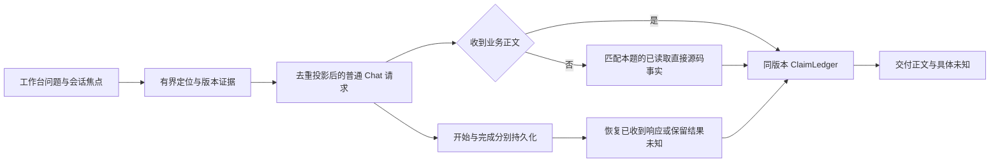

# 交付目标调度调查，不中断正在返回的首答

当前默认工作台把 `max_question_seconds` 同时作为调查调度目标、请求超时上限和取消回调。整题达到目标时，正在进行的 HTTP 请求也被关闭；尚无正文时，只显示 `QUESTION_TIME_BUDGET_EXHAUSTED`，尽管原版本源码已经读取。这是交付缺陷，不能通过缩短截止时间或放宽答案正确性解决。

保留 Python 模块化单体、现有默认入口和 SQLite 请求日志。`max_question_seconds` 保留配置兼容性，改为交付调度目标：达到目标后不再扩展可选调查，优先用实际供应的证据回答；已发出的请求继续按照独立 HTTP 超时与用户取消处理。需要硬停止的维护场景须显式设置 `hard_question_seconds`；默认没有该硬截止。请求次数、原有 HTTP 超时、输出额度不增加。

模型接口失败、只返回计划或没有正文时，本地回答只使用本题实际供应且有哈希的源码页，保留限定字段、语句 occurrence、条件及 COPY 身份，并通过相同出口核验。无相关事实时不编造业务解释。此类回答明确为 `local_source_facts`、`PARTIAL`，不计为模型回答完成，也不把直接语法支持宣称为执行路径或整篇业务语义已验证。来源、正文、证据和核验结果随历史保存；远程结果未知时保留已交付正文，禁止自动重发。

性能改动减少实际工作：提示投影共享重复导航记录，但不删源码、版本、引用或出现位置；字段绑定先用已有路径索引收敛候选，再关联唯一声明，不用候选截断冒充唯一命中。触发类问题在本地核对入口、真实调用点及供证控制条件，确定性补读在首个模型请求前完成；未供应的调度配置保持未知。新增安全耗时记录区分响应头、首个 HTTP 正文字节、完整响应和本地处理。首个 HTTP 字节不等同模型首 token，不能据此断言公司网关排队或推理耗时。

同一物理源码页从读取器和语义服务进入证据池时，包含链可能分别使用列表和元组。原先直接比较容器类型，会把相同内容误判为 `EVIDENCE_ID_CONTENT_MISMATCH`，使深分析供证失败。去重比较现在接受这两种序列的相同有序内容；真实路径、行段、哈希、原文及包含链差异仍拒绝。默认初始化回归直接验证语义证据组被接收，无需模型调用。派生质量版本更新，旧答案与旧评审仍归属于原版本，不迁移评分；解析缓存无需因这个表示修复而全库重建。

明确询问计算与累加时，计划、供证义务和答案覆盖共同记录实际累加步骤。候选来自本题范围内已供应的 ADD 或自读加法赋值，不能把常量重置、无关计数器或文件写入未知当成已经解释累加。有限覆盖检查接受有真实引用的正确短答，仍标明自然语言语义未核验。最终 EXE 的原有月息样本分别检查正确累加和修订公式后仍漏累加的反例；不改合成正文来消除遗漏，也不将反例被检出称为模型准确率通过。

考虑过仅调大整题时限、仅返回错误提示、取消后自动重试、所有错误都再问一次模型。前两者没有改善交付；自动重试有重复收费风险；额外模型核验增加延迟且不能替代源码支持。保留独立 HTTP 超时和请求日志，以免“等待首答”变成无限等待或隐藏不确定状态。

验收在既有 55 个原生样本上增加 3 个慢响应样本和 3 个自然 batch 触发样本，保持原来的 14 个语义范围探针。新增样本要求越过交付目标仍接收首答、请求日志仅完成一次，并继续纠正错误公式、保留独立 MOVE 事实与原版本引用。明确硬截止和用户取消仍作为生命周期反例验证，不能用这些停止行为证明业务速度通过。离线机制与真实模型质量、速度及公司设备验收分别记录；最终 EXE 的同包正式发布门禁继续执行。
