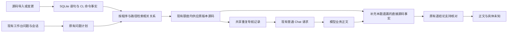

# 索引批次上下文并在本地补充已供应的业务事实

默认工作台需要同时改善业务完整度和调查开销。上一轮比较发现，CL 批次入口和文件环境尚未接成可查询关系；构造的不完整答案经过公式修订后，仍可遗漏同一证据中的累加和条件。提示中也存在重复参数和导航记录。用户明确要求保留现有交互，不增加挡住结果的冗余校验，并提供可在办公室试验的 Windows 候选。

沿用 Python 模块化单体、SQLite 全库索引、按题 sidecar 和 `indexed_chat → business_chat` 默认链。在导入/刷新时保存有来源的 CL 命令事实，按目标程序及路径索引查询，在既有本地读额度内供应相关原文；提问时不重新扫描全库。命令事实与运行效果分开：源码中提交作业、调用和文件覆盖的声明可以解释，实际调度、作业描述、库列表绑定、对象解析、事务与表数据没有证据时仍未知。

本地补充限于当前问题、当前实际供应的原文和受支持的语句关系；公式、字段、常量、条件、效果和引用同源。保留正确正文，只增加尚未说明的必要事实，不调用第二个模型来验收答案，不增加收费请求或自动重试。正确短答不以固定章节为条件；局部未知不剥夺其他结论。解析、绑定、静态可能效果与实际执行状态继续分别保存，局部补充不使整篇自然语言自动变成“已核验”。

重复信息在发送投影层共享，canonical 证据、历史、原文、哈希、COPY 身份与每个 occurrence 保持原样。独立解码必须恢复同一对象；省下请求字节不直接等同 token 或远程耗时改善。追加索引事实需要版本失效和显式刷新，答案/提示版本变化仍绑定新的运行与评审身份；旧答案保留旧证据。

该决定增加了有限语言适配和本地补充代码的维护成本，也可能增加短小的源码补充文本。因此需用错误常量、缺累加、分支、异常、短答、限定字段和无关程序等反例限制其范围，记录准备、请求和最终交付阶段的耗时与请求数。保留现有用户取消、独立 HTTP 超时和未知远程结果日志。

考虑过增加前端确认、每题再请求模型验证、直接替换第三方图、仅缩短整题时限。前两项增加交互或延迟；外部图仍有实测语义错误，需要适配和验证；时限不能替代完整业务解释。此次继续在现有默认路径改善实际材料与输出。

Windows 候选必须通过同包原生离线回归，增加 CL 与本地补全检查。可下载候选供办公室试验；真实模型、人工业务评审及目标设备验收未完成前不转为正式版，正式发布仍使用既有唯一发布入口。

CL 词法及上下文依据：[IBM CL 续行规则](https://www.ibm.com/docs/en/i/7.5.0?topic=parts-cl-command-continuation)、[SBMJOB 参数](https://www.ibm.com/docs/en/i/7.5.0?topic=ssw_ibm_i_75%2Fcl%2Fsbmjob.html)、[覆盖处理范围](https://www.ibm.com/docs/en/i/7.5.0?topic=overrides-how-system-processes)。适配器只处理所列有界来源事实，不构成 IBM i 编译器或真实框架认证。
