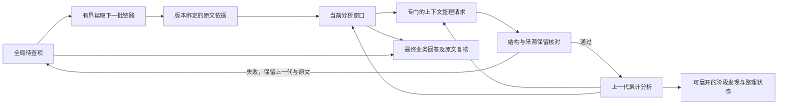

# 保存累计分析与全局待查项，在上下文压力下整理而非遗忘

多轮调查会读到超过单次请求容量的源码。只保留最近片段、仅增加回读目录，或用当前批次的证据充分性结束整题，都可能使早期规则、调用条件与尚未遍历的分支消失。决定将不可变的原文依据、可压缩的累计分析及可续查的全局待查项分开保存；上下文压力触发专门的整理请求，后续轮次继承通过核对的累计分析并继续读取剩余链路。

这延续 ADR-0015 中“调查和记忆不由预算开关决定”的原则，但不沿用其已经过时的默认六次请求及 180 秒描述。当前默认不设置整题请求次数和时间上限；显式配置的上限仍约束同一次调查，整理、生成和复核共享该额度，恢复不能补回已用额度。该决定不取消单次请求容量、网络超时、取消操作或正式桌面发布验收。

## 保留什么，何时允许替换

累计分析保存业务规则候选、条件与排除项、处理顺序及参数或结果交接、冲突、待查事项。每个条目绑定实际供应过的源码依据；下一代必须逐项覆盖上一代的关联，保持条目类别和来源，不能把冲突或待查事项在整理时直接改成已解决。新来源必须进入候选解释或明确列为延后处理，不能无声省略。仅在完整输出通过结构、来源和容量核对后原子替换工作摘要，旧代及原始依据仍在本地保留。

摘要属于候选解释，不直接取得事实或运行正确性权威。后续请求中的完整摘要声明可恢复其绑定原文的引用资格；最终核对读取对应版本、行范围和包含实例的原文，不能用摘要替代原文证明自己。摘要声明、源版本或实际请求记录不一致时，不恢复相应引用资格。结构核对能发现遗漏条目及来源断裂，不能保证模型没有在改写中丢失语义细节，因此界面和报告不得称其为“语义无损”。

全局待查项保存尚未读取的来源、待展开关系和未完成义务。单次文件数、规则数或读取窗口限制只定义一个批次，不能等价于整题调查终点。当前批次的局部可回答性与整题完成分别记录；动态调用未解析、资料缺失、预算到达等边界须保留并解释。它保证已发现工作不会因分批被遗漏，不声称能证明未知入口或所有运行路径都已发现。

同一会话内的普通追问也可以继承累计分析，而不要求用户点击“继续补查”。继承须从本地记录核对会话归属、唯一明确的业务对象、源码与编译上下文版本、框架设置和原始请求证明；对话中传递的编号只是查找入口，本身没有证据权威。符合条件时保留原文、累计分析代次及兼容的来源待查状态，新问题重新建立自己的回答、证据义务和请求预算。换题、对象歧义、源码或配置变化、归属不符以及远端请求结果不明时不沿用旧分析；同一道未完成问题的恢复仍继续原有额度。

## 恢复、成本和展示

整理使用现有模型通道，原文访问及外传权限不扩大。保存待执行任务与真实响应记录，使中断后能重放已收到的响应，而不会因重连重复发送。整理失败、输出被截断、来源校验失败或容量仍不足时，保留上一代、原文和待查项并显示未完成；不得为了继续生成而静默裁掉累计分析条目。同一材料的失败不触发无休止的自动整理循环。

这比仅保留最近片段增加本地保存量，也增加模型请求、延迟和恢复状态管理。保留完整源码到每个请求则会超过容量；只用自然语言对话摘要无法证明来源连续性；自动扩大所有请求容量仍会在大代码库上再次遇到边界。因此选择有界原文批次、可审计的累计分析和持久待查项，并在测试中分别验证来源、保留关系、恢复和全局续查。

界面默认显示简明进展，并可展开阶段发现及整理前后容量、保留条目和待查状态。摘要中的待查事项与引擎登记的全局待查记录分别显示；一条链路可能对应多个工作记录，记录数不冒充独立路径数，未取得状态也不能显示为零。阶段发现是可审计的工作结果，不是模型私有思维链。选择“仅进度”只改变展示，不减少后台调查或改变分析范围。来源已供应、形成候选解释、源码支持结论和全局仍有待查项是不同状态，不得合并为一个“已完成”百分比。

## 验证边界

回归必须覆盖多次整理后仍能复核早期原文、条件与交接没有被后续批次覆盖、未读关系和规则继续分批处理、无效整理不替换上一代、取消与恢复不重复请求、有限预算被共同消耗，以及界面重连能恢复最新阶段状态。合成模型只能验证协议与状态连续性；业务解释质量仍须由最终同包真实模型与目标设备验收确认，不能据此直接替换正式发布版本。
