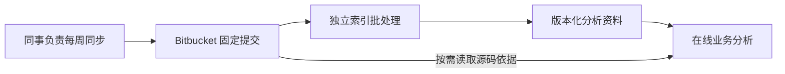

# 在线索引独立消费 Bitbucket 固定提交，不依赖上游同步实现

2026-11-07，用户明确每周 AS400 → Bitbucket 同步由同事负责，自己不掌握也无需了解执行机器、操作系统或脚本。此前要求同步程序出具完成凭据，并推荐直接在同步机器追加索引任务，会把分析系统的接入前提延伸到用户无法控制的工作环节。

在线分析从 Bitbucket 已有的固定提交开始，独立运行预计算和发布。默认部署方向是独立批处理任务；Bitbucket 托管 Pipelines 是待公司权限、网络与资源验证的候选，不把同事的同步环境作为必需运行位置，也不要求修改同步程序。已有同步完成声明可以继续使用，但只作为可选来源依据。此边界基于用户明确修正；实际环境部署和业务验收仍待执行。

资料必须对应固定 commit、源码范围、解析配置和受 Git 核验的文件内容。新增显式仓库快照发布方式，其来源记录标明上游同步完整性未确认；旧同步凭据方式及其校验继续保留。发布仍先核对所有资料，再写入不可变发布描述；失败不替换旧版本，业务对话固定在明确选择的版本。

这个选择接受一个清楚的边界：如果同事一周分多次 push，独立任务可能取到中间提交。即使分支一段时间没有变化，或定时任务已经到点，也不能据此证明周同步全部完成。系统可以分析该提交，但只说明“基于这个版本”，不声称它代表本周全部 AS400 源码。后续版本可另行发布和选用，旧对话继续可追溯。

强制同步完成凭据能表达同步方的完成声明，却要求改造外部流程，因此不作默认门槛。固定等待时长无法证明同步完成，不能替代声明。每个业务客户端自行下载全库违反本轮目标，继续排除。复用同步机器可以减少重复传输，但只有今后条件明确且获准时才作为优化，不阻挡独立接入。

这项决定只改变在线发布的来源契约和部署依赖；不改变本地分析、现有网络策略、源码外传与真实模型授权，也没有启用流水线或构建应用包。独立索引仍需获准的计算与资料存储位置；源码放在 Bitbucket 并不意味着分析任务已自动配置。具体命令与部署条件见[在线工作台使用与部署](../20-bitbucket-online-workbench.md)。
