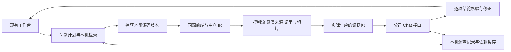

# 默认业务分析质量升级

这轮改动把共享源码事实、局部流分析和结论核验接入原有工作台。实际起点是 `main` 的 `d8eda68`，审阅提交 `7dd3e570eb3a80f8739d2065a11212d1db18e7b7` 只作为历史参考；未回退已有调查恢复、调用时点和来源修正。执行日期为 2026-10-13 至 2026-10-14。升级前离线基线为 2,140 项 Python 测试通过。

## 默认工作台流程

网页首次提问与已有索引追问继续使用 `indexed_chat.py → business_chat.py`。全文检索、business_sparse、问题侧库、内容捕获、COPY 溯源、公司接口与 CA 设置保留。自然问题形成本地 AnalysisPlan，来源、覆盖、条件及影响调查复用同一语义服务；普通 Chat 接口继续可用，模型提出的对象和工具参数须通过本地核对。



公式核验在最后出口执行，覆盖初答、续答及修订。`OUT-AMOUNT = IN-AMOUNT * 2` 的合成源码配合真实供应证据 ID，模型若写成乘以 999，会在本地改成受支持的表达式。结论账本保留原错误、版本、支持范围及修正结构；普通正文仍可能包含尚未支持的语义，因此整体 `claims_semantically_verified` 保持 false。错误引用会触发相关陈述复审，而不是只去掉标记。

## 同源语义与调查结果

词法前端共同处理字符串、注释、续行、限定字段和语句作用域。ADD GIVING 只写真正接收结果的字段，同一实际字段的输入与输出角色分别保留；终止词和限定词不成为额外操作数。同一物理行的每条语句、相同语句的不同分支、重复调用及 COPY 实例保留独立出现位置。

CompilationContext、ParsedStatement、DataItem、DataRef、StorageRegion 和 SourceRef 保持解析、绑定及流关系三种状态。过程 COPY 支持受控嵌套、替换、已知库顺序及有限条件编译；未知配置保留候选和来源诊断。IR 存入问题侧库，按程序读取。固定 ProLeap v2.4.0 已实际隔离编译并运行 ASG，经中立桥比较得到 12 项语句正确、1 项作用域不支持、0 项错误；Che4z 仍为未实跑的候选。实际构建、依赖哈希及规范化 IR 见[解析器试接记录](../research/parser-adapter-trial-v1/README.md)。

局部服务提供 `backward_slice`、`forward_slice`、`explain_assignment`、`trace_parameter`、`explain_external_effect`，复用顺序、IF/ELSE、EVALUATE、PERFORM、受支持循环与异常边。到达定义、控制依赖及后续写入分别保存；A→B→C 静态调用使用已有实参形参布局核验后绑定上下文。未知调用效果无法界定时扩大存储范围，直接源码赋值仍可独立解释。数组、重定义、复杂布局和递归须按实际诊断判断支持范围。

金额表达式与字面量使用十进制结构；接收语义包含 PIC、USAGE、尺度、ROUNDED、截断及 SIZE ERROR。显式数值转换须选择受支持的接收 profile；默认结果不会把 Decimal 运算当作完整 COBOL 执行，更不会据源码生成实际表数据。

框架调用复用原有 `framework_*` 能力，通过版本化效果契约保存调用形态、记录布局、输入输出、状态和外部效果，以及手册、源码、配置或人工确认的依据类型。契约与实际调用点共同供证；版本冲突保留为候选和缺口，文档不会覆盖源码。COBOL 文件及 SQL 的直接语法事实与真实读写成功分开；IBM i DDS/CL 等企业目标仍须以明确 profile 和获准样本验证。

## 运行与评审身份

`investigation-runs.sqlite` 保存调查、步骤、供证、未完读游标、义务、frontier 和额度。进程在请求完成后中断可复用已记录的业务正文，远程结果未知时停止重发；正常错误后的用户手动重试仍保留。派生缓存按来源、编译上下文和语义服务版本绑定，选中文件刷新会失效相关流及摘要，依赖链可传递失效。

恢复身份还绑定所选入口、会话焦点、框架资料目标、源码根目录及索引。切换程序后提出相同问题会使用自己的调查；回到原入口能复用原回包。较早的匹配调查不会因另有 32 条新记录而丢失，未完调查的分析或提示版本变化会明确停止重放。节点预算耗尽时，冷结果及缓存结果均标为不完整流。

人工评审绑定 run、case、turn、branch、源码与框架版本、答案 hash、模型、prompt、policy、gold 和实际供应证据。旧评审身份不匹配时显示 stale；表单完成率和答案正确性分别统计。原归档答案的评审可离线附回原报告，不需要读取更新后的源码或再调用模型。

未知输入、调用或配置只影响相关义务；有独立源码支持的计算、条件及写入继续保留。正确短答不要求固定章节，未覆盖的语义也不会被标为已核验。

## 使用方式

照常启动 `python3 poc/web_app.py`，导入本机源码后直接提问。旧解析版本的索引须通过现有“更新本机源码”入口更新一次。可使用“这个字段从哪里来的？”、“为什么最后变成零？”、“前面的计算为什么没有生效？”、“修改这里会影响哪些结果？”及“刚才第二种情况呢？”；无明确会话焦点时会记录具体的指代缺口。

已知编译设置可在工作台高级读入选项填写本机 JSON 文件，命令行等价为 `--compilation-context /absolute/path/compilation.json`。例如：

```json
{
  "dialect": "generic",
  "source_format": "fixed",
  "copy_libraries": ["copybooks", "shared"],
  "copy_library_order_known": true,
  "compile_conditions": {"FEATURE": true},
  "conditions_complete": false,
  "framework_version": "1"
}
```

恢复中断调查沿用相同问题与同一模型配置；程序接口还可传 `resume_run_id`。已完成步骤和证据继续使用，未知远程请求不会自动重试。结果中 `run_id`、`claim_ledger`、`investigation_state` 和质量 trace 可以分别核对调查、结论及实际供证。

## 验证记录与边界

最终[完整离线验证记录](./2026-10-13-verification.json)：2,336 项 Python 测试、162 项网页测试全部通过，包含固定公开源码验收；294 个 Python 文件通过 3.10 语法检查，网页脚本语法和 diff 检查通过。测试前后产品代码与夹具的聚合 SHA-256 一致。完整测试的实际运行环境为 Python 3.14，3.10 记录仅为语法兼容核查，不能替代该版本实机验收。

[反例前后对照](./2026-10-13-semantic-counterexamples.json)包含七个案例、两类索引上的 14 项核验，新版全部通过，旧版 12 项失败、2 项已有正确能力保留。[合成 IR 与摘要切片](./2026-10-13-semantic-sample.json)保存实际共用服务生成的三程序样例，含 12 个出现位置、13 条 CFG 边及到达赋值、控制条件与覆盖关系。规模反例保留 5,000 个相同语句的位置同时去重为一个形态，按程序读取及重复调用解析复用的实测计数见前后对照。公开 CardDemo 的固定提交为 `59cc6c2fd7ebd7ef7925cad552a01a4b8b6e4d5e`，验证超限拒绝、账户更新、月息、文件映射与费用未实现；5 题 7 个默认链分支均通过，结果见[公开验收记录](../eval/public-business-v1/README.md)。原始公开源码仅下载到临时目录。公开验收使用 fake transport，验证的是默认链机制与真实供证，不能据此给出真实模型准确率提升。

独立审查另外复现并修复三项机制：公式引用不能遮掉其他已供应原文中的后续清零；节点超限不能标完整流；更换入口不能恢复另一程序的答案。三个原反例经独立代理重跑均通过。最终值的核验仍须有控制流和覆盖证明；账本保留可单独成立的计算与后续写入事实，不把语句语法支持提升为最终值证明。

[公开留出题](../eval/public-reserved-v1/README.md)另行冻结 4 组、6 回合，包含三轮同义及指代问题，不根据结果调实现。离线实际供应目标程序为 6/6 回合；完整审阅范围原始统计为 3/6，其中一项黄金范围越过真实文件末尾两行，保留原身份并登记勘误后为 4/6。其余两项追问仍未覆盖全部审阅范围，作为供证召回缺口保留。业务正确性及真实模型准确率未评分，不能把这组结果写成答案正确率。

公司模型业务验收、获准企业目标方言、Windows 实机和实际发布须分别记录。本报告记录升级开发完成时的离线验收快照：当时未新增收费调用、企业数据外传、推送或发布；后续获授权的源码上传与应用发布，以 [GitHub 发布说明](https://github.com/madaraoflee/cobol-evidence-analyst/releases/latest)记录的提交和平台核验为准。工作区同时出现的源码可用性与范围导航改动按共享现状保留，不归为本轮新实现。
