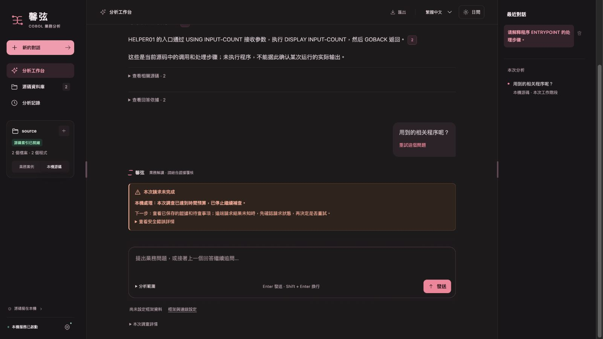
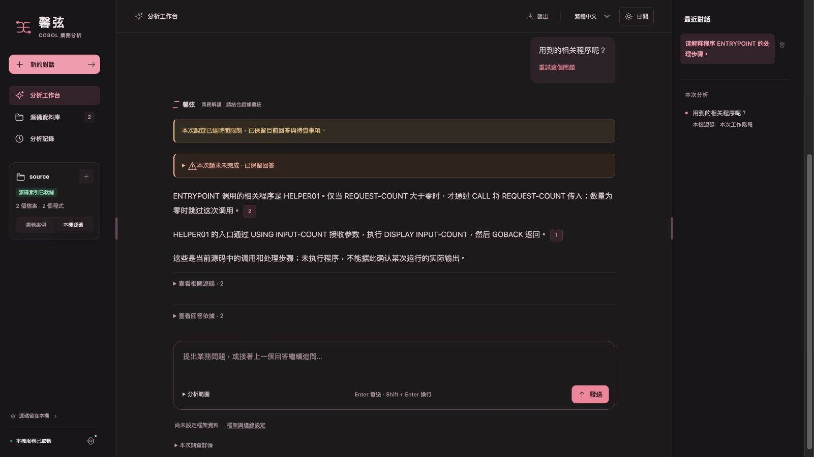
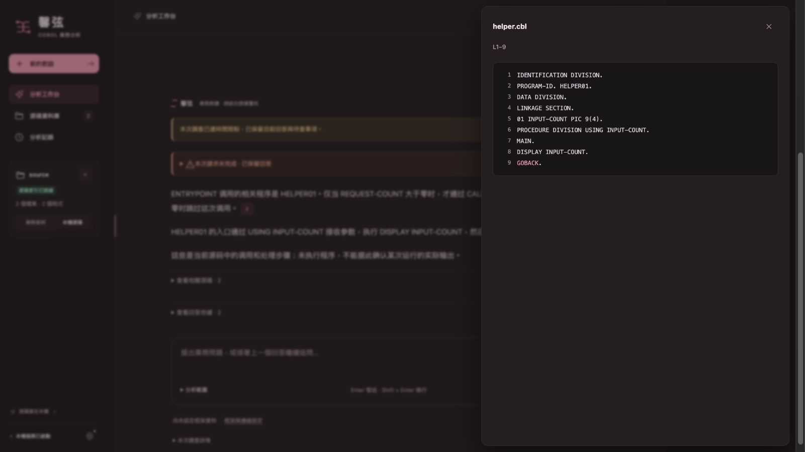

# 超时后的答案交付与相关程序追问修复

用户确认问题出现在 v2026.10.20.3-rc.1。本轮在该版本提交 `3217adf2469729a17dc19b1b28691984872c8bff` 上，用同一组中性源码、同一段脚本答复和相同故障注入复现：模型正文已收到，随后可选补读跨过期限，旧版丢弃正文，只剩 `QUESTION_TIME_BUDGET_EXHAUSTED / response_validation` 错误卡。修复后保存正文、引用和待查状态，重新打开工作台也能阅读和核对原文。

这证明该版本存在能够造成截图现象的缺陷。未取得用户 Windows 当次运行日志和源码，因此不把合成复现的计时冒充用户那次实际耗时，也不声称已经排除所有超时原因。

## 修复行为

可用答复在继续补查前绑定当次证据并保存；完整响应收到后的本地交付不会再被调查期限抹掉。正在传输的请求仍受硬期限控制，用户取消仍优先。下一轮是否继续规划同时考虑已观测的请求等待和回答预留，必要的便宜本地读取使用独立判断，避免先耗尽时间才要求回答。默认 180 秒硬期限、6 次请求及源码材料额度未增加。

“用到的相关程序”现在查向外调用，“哪些程序用到它”查调用者；明确的新程序优先定位，明确的未知程序不会被旧对话主程序冒名替代。关系题首次请求须实际包含对应 CALL 原文，不只传一个索引路径；尚缺的已定位调用点沿用既有读取额度。查询针对已有关系及有限原文，不扫描整个库寻找一份无限完整的调用清单。

模型没有交付正文时，唯一且重新验证的关系主体可生成有引用的本地 CALL 事实说明；实际携带并验证过的历史源码页也可参与。此类结果明确标记为 `local_source_facts`，不冒充模型回答或完整程序清单。旧结果页同步保留其正文和引用，纯诊断仍单独显示。界面布局没有重做。

## 相同场景的前后对照

夹具为 `poc/tests/answer_delivery_fixture.py`，端到端回归为 `poc/tests/test_answer_delivery_workbench.py`。真实运行工作台分析入口、源码读取、答复处理、运行检查点、对话存储和重启恢复；只替换模型传输为脚本，并注入调查时钟。先问“请解释程序 ENTRYPOINT 的处理步骤。”，再问“用到的相关程序呢？”。脚本只有在实际请求同时带有调用方 CALL 和被调程序 DISPLAY 原文时才返回回答。

答复在虚拟第 119 秒收到，可选补读把时钟推进到 181 秒。旧版第二题为 `ABSTAINED / diagnostic / model_answer_recorded=false`；修复后为 `PARTIAL / model / model_answer_recorded=true`，保留调用条件、参数、被调程序处理及两条有效引用。两版各执行两个脚本请求；外部请求和付费模型请求均为 **0**。不足一秒的夹具墙钟时间不代表真实模型回答速度。

原始对照的公开摘要、正文和截图摘要见 [before-after.json](before-after.json)。以下为真实浏览器截图，没有拼接或改写页面；答案来自离线脚本，不是新增真实模型验收。

修复前：

修复后，重启工作台仍可阅读问答：

点击被调程序的引用，核对原文：

## 验证和发布范围

针对性测试覆盖收到答复后超时、慢接口后提前综合、收尾阶段停止可选读取、用户取消、历史源码记忆、调用方向、明确未知程序、错误版本及排他范围。最终全量 Python 回归 **3,367 项全部通过，无跳过**，耗时 **182.94 秒**；页面回归 **192 项全部通过**，413 个 Python 文件通过 3.10 语法解析。[完整验证记录](validation.json) 同时保存每项结果与测试文件摘要；修复后产品及新增夹具摘要绑定于前后对照记录。

本轮遵守当前 `AGENTS.md` 的 bug-fix phase，仅修改和验证源码并同步 GitHub；没有构建可运行 app、Windows 安装包、验收可执行文件，也没有触发相关构建工作流或生成新 Release。已安装的 v2026.10.20.3-rc.1 不会因源码提交自动更新。本次未追加真实模型费用，也没有将用户截图、私有业务标识或私有源码放入公开夹具。
