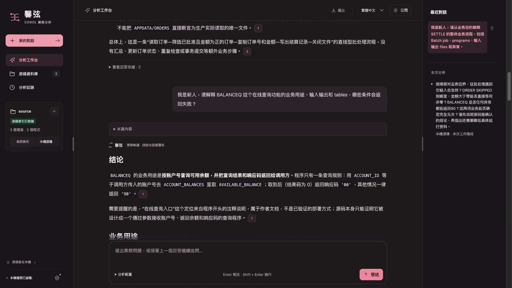
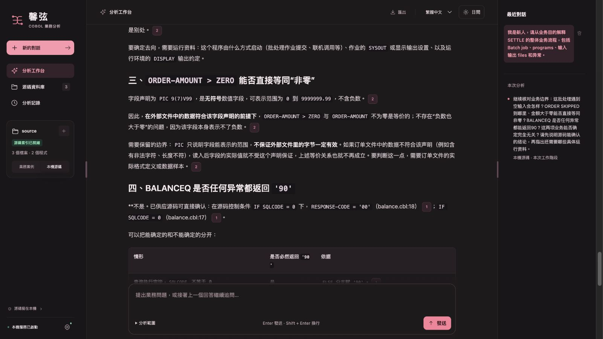

# 业务边界、批处理供证与真实问答复验

最后付费复验覆盖了限定的 12 个核心检查项，但**全文仍有 1 处实质错误和 5 处次要问题，整体质量不通过**。其中 7 项来自历史批处理、在线回答，另外 5 项来自新独立会话中的边界题；这不是同一最终版本、同一设置下三题全部重测。界面布局没有修改，候选发布也不代表答案正确或目标 Windows 设备验收完成。[最终独立评审](independent-review-final.json)

## 最后真实结果与适用范围

[联合原始结果](real-model-results-final.json)保留实际模型正文、交付正文、各次请求、源码引用与哈希；文件名中的 `final` 表示本轮最后选定记录，不表示质量通过。评审由独立代理对照冻结源码完成，未经目标设备人工验收。

| 题目 | 实际生成版本与设置 | 请求数与观察耗时 | 这份记录能证明什么 |
| --- | --- | --- | --- |
| 批处理业务概览 | 阶段 4，pipeline v39／prompt v35，medium、详细回答 | 2 次，66.971497 秒 | 历史 4 项核心要求满足；首轮 length 后续写。最终 v43 后处理离线重放与历史交付逐字相同，未用新生成策略重新回答。 |
| 在线查询业务概览 | 阶段 4，pipeline v39／prompt v35，medium、详细回答 | 1 次，20.985261 秒 | 历史 3 项核心要求满足；最终 v43 后处理离线重放逐字相同，未重新生成。 |
| 业务边界题 | 阶段 10，pipeline v43／prompt v38，low、简要回答，3072 输出上限、32768 请求字节上限 | 1 次，14.298716 秒 | 新独立会话实际 2 条消息；三份中性源码共 65 行完整供给。5 项核心要求满足，正文仍有下述错误。 |

最后一题在原问题前增加了“请基于 nightjob.clle、settle.cbl、balance.cbl。”这一来源范围前缀，以便没有历史的新会话明确所指对象。原问题全文、前缀及两者哈希均保存在[阶段 10 原稿](real-model-results-phase10.json)，金标准没有改变。这个问题变体、空历史、推理强度、篇幅和输出额度均与历史两题不同，**14.30 秒不能作为代码提速的因果证据，也不是 p95 基准**。[逐题耗时拆分](latency-breakdown-final.json)

历史两题只做了[最终 v43 后处理重放](final-postprocessing-v43-replay.json)，验证引用修补、续写拼接及显示整理没有改写正文，不证明它们在新历史投影或新提示词下还能生成同样答案。截图使用两个独立真实会话：历史阶段 7 的 10 条消息与阶段 10 的新 2 条消息；旧阶段 9 的 12 条消息另行保留，没有拼造一个 14 条消息的连续会话。

最后一题的原始模型正文与交付正文逐字相同，没有本地改写、截断、断引用或重复续写。但摘要写“也没有文件/数据库状态检查”，与已供应 `balance.cbl` 中的 `IF SQLCODE = 0` 检查直接冲突。正文随后正确解释零／非零分支，不能消除摘要中的相反事实。这一处实质错误决定全文不能通过。五处次要问题是：UNTIL 结束条件措辞倒置、正常关闭的运行限制不够明确、泛称无范围检查、把静态未见关系说成“互不影响”，以及摘要计数与实际条目数不符；原文与逐项判定均保留在[最终评审](independent-review-final.json)。

产品将最后一题标为 `PARTIAL`，直接原因却是把“若要知道……还需确认……”这种待核要求误当成已成立的全异常返回保证；它没有提名上述真正的数据库状态检查错误。显式策略仅允许一次请求、零次修订，因此没有追加模型调用，原答与具体风险一并保留。`PARTIAL`、`ANALYZED`、引用有效、核心项齐全或有限校验器零矛盾，都不能替代完整内容评审。

## 实际页面截图

以下八张图片来自两份真实会话的只读离线副本，截图时阻断模型网络，正文和图像像素均未改写。01—04 是保存在阶段 7 历史中的阶段 4 原答；05—08 是阶段 10 的新独立原答。它们不是同一会话的连续 14 条消息，也不代表 Windows EXE 实测。每张文件哈希、实际会话长度和来源版本见[截图来源清单](screenshots-provenance-final.json)。

| 图片 | 内容与限制 |
| --- | --- |
| [01 历史批处理问题与回答](01-historical-batch-question.png) | 历史 v39 原答，10 条消息的保存会话。 |
| [02 历史批处理文件角色](02-historical-batch-files.png) | 同一历史回答中的输入、输出和业务角色。 |
| [03 历史在线问题与回答](03-historical-online-question.png) | 历史 v39 原答，未在最终生成策略下重问。 |
| [04 历史在线返回表格](04-historical-online-table.png) | 同一历史在线回答的分支说明。 |
| [05 新边界题摘要](05-final-boundary-summary.png) | v43／low／简要模式，独立 2 条消息。 |
| [06 新边界题的已知实质错误](06-final-boundary-known-error.png) | 原样保留“没有文件/数据库状态检查”的错误，不能据截图宣称内容通过。 |
| [07 新边界题 SQL 适用范围](07-final-boundary-sql-scope.png) | 正文中的正确限定不消除摘要中的相反事实。 |
| [08 新边界题关系与缺失资料](08-final-boundary-relationships.png) | 保留原答的局部关系判断、限制及待补资料。 |

## 本轮修复了什么

批处理概览原来把两项内部漏识别混入缺证状态：实际已供应的 CL `CALL` 没进入启动证据，完整 `SELECT`／`FD`／`READ` 也没进入订单字段来源。现在按同版本物理原文及成功读取的控制条件绑定。静态业务概览可以解释已见作业、程序、文件来源、筛选条件与写出请求；缺少调度配置仍限制调度结论，但不再让其他已有源码依据的解释整体失效。局部 I/O、异常或金额追问仅出现“批处理”一词，也不再强加未问的启动调查。[源码结论与所需资料](source-conclusions.json)、[离线供证与范围验证](offline-source-scope.json)

本地核验修复了同一行 `ELSE MOVE` 漏掉假分支、条件摘录被截成独立赋值等误反证；不完整控制块维持未知，真正错误的完整条件、分支、公式及假引用仍保留检查。未闭合引用的续写修补只处理实际供应过的引用前缀；续文若能直接补全该引用，则保持原拼接。上述机制不以固定模板替换业务正文。[原始三题离线校验重放](offline-conditional-excerpt-replay.json)

对无条件异常返回、非法输入必失败、跨调用异常后仍继续、空输入零次进入含 READ 的循环，以及输出仅成功时赋值等明显风险，系统以当前实际源码提名具体复核候选，再沿现有有限请求与修订额度处理。候选不是错误判决，候选消失也不是语义证明；运行前提、否定、具体值限定及其他子句不能被混用。没有新增固定整题截止后丢弃答案的机制；请求、I/O、取消、修订及无进展上限继续生效。[阶段 2 风险重放](offline-semantic-risk-phase2-replay.json)、[阶段 3 风险重放](offline-semantic-risk-phase3-replay.json)

历史投影还处理了旧错误解释被反复供应的问题。阶段 7 的实际历史共 18,000 字，其中 assistant 正文 17,709 字（98.4%），两份已失败边界答复占 9,264 字，当前原始源码为 1,497 字。[实际角色与字符审计](phase7-wire-history-audit.json)逐条绑定了持久消息哈希，但没有据此宣称唯一成因。完整会话继续用于本地焦点恢复和来源定位；明确独立的源码问题不再默认重复供应旧解释，回顾、引用或编辑旧答以及无独立主体的短追问仍保留所需历史。

## 原始失败与验证过程

[原问题及金标准](../../eval/business-boundaries-v1/cases.json)在请求前冻结。各阶段的失败、原稿、交付、用量和版本均独立保存，没有用新答案覆盖旧结果。

| 阶段 | 实际结果 | 原始证据 |
| --- | --- | --- |
| 1 | 9／12 核心项满足；在线过度保证返回码，非法输入被等同失败，本地误改正确 IF／ELSE。 | [问答](real-model-results-initial.json)、[评审](independent-review-initial.json)、[3474 项源码验证](offline-validation-initial.json) |
| 2 | 8／12；跨 CALL 异常后继续、零账号必失败漏检，正确否定误报并消耗复核。 | [问答](real-model-results-phase2.json)、[评审](independent-review-phase2.json)、[3499 项源码验证](offline-validation-phase2.json) |
| 3 | 仍失败；误说空输入循环体一次也不进，及响应码只在查询成功后赋值。 | [问答](real-model-results-phase3.json)、[评审](independent-review-phase3.json)、[3505 项源码验证](offline-validation-phase3.json) |
| 4 | 12 个有限核心项满足；边界题续写后留下断引用，完整交付失败。medium 设置与此前 low 不同。 | [问答](real-model-results-phase4.json)、[评审](independent-review-phase4.json)、[3513 项源码验证](offline-validation-phase4.json) |
| 5 | 边界 4／5，组合历史为 11／12；局部摘要缺正常 I/O 前提，另有无依据 DISPLAY 去向、过强后续保证与重复半句。 | [问答](real-model-results-phase5.json)、[评审](independent-review-phase5.json)、[源码验证](offline-validation-phase5.json) |
| 6 | 输出配置 12288 超过产品支持上限 8192，发送前拒绝；零请求、零新增费用，原 8 条历史未变。 | [初始化失败与历史核对](phase6-initialization-failure.json) |
| 7 | 一次请求 30.40 秒，无截断，但边界仍 4／5；仅加强生成政策未解决局部前提问题。 | [问答](real-model-results-phase7.json)、[评审](independent-review-phase7.json)、[3519 项源码验证](offline-validation-phase7.json) |
| 8 | 历史投影的 3525 项离线回归拦住两个既有追问兼容问题；没有发送模型请求。原断言保留后修复。 | [失败源码验证](offline-validation-phase8-failed.json) |
| 9 | TLS 握手失败，响应字节为 0，无模型正文和用量；界面只有有限本地源码事实，不能给模型答题评分，也不能把 5.199 秒算作回答速度。原请求未知预占保留。 | [失败记录](real-model-results-phase9.json)、[独立评审](independent-review-phase9.json) |
| 10 | 独立短答、一次请求；5 个核心项满足，额外 1 处实质错误与 5 处次要问题，整体失败。 | [问答](real-model-results-phase10.json)、[最终独立评审](independent-review-final.json) |

## 首次 Windows 原生验收失败与修复

首次手动构建 [run 39453762658](https://github.com/madaraoflee/cobol-evidence-analyst/actions/runs/39453762658) 使用提交 `b666607398c9568c80dd2e718af3ced875d5dd55`。最终 Windows EXE 的 25 案例、79 样本中，76 样本通过，3 个 `cl_late_context` 样本在同一个检查上失败；该次构建没有成为已发布候选，不能写成“Windows 79 样本全过”。[失败报告摘要、原报告 SHA 与独立核对](windows-native-attempt1.json)

失败的旧断言和模拟答复都要求“前序控制范围未供”，但实际首请求已同时供应 `late.clle` 第 3 行 IF 与第 304 行 CALL。三个样本的源码版本、物理范围及原文哈希均吻合；已见静态条件不等于条件实际成立，也不证明程序对象、调度或执行已确认。生产层另有一处元数据矛盾：静态范围已知时仍保留缺证原因。

后续 **v45／prompt v40** 只修正这项原因归属，并将旧断言改为更严格的两项检查：实际请求中每个守卫的引用 ID、同版本源码哈希、物理区间和逐字原文均匹配；条件取值、对象绑定、调度和运行执行仍须未验证。模拟接口据实际供证返回带条件的源码解释，缺守卫、错误来源与错误版本等负例继续拦截。其他 24 案例未改，晚调用案例的速度、请求数和不得重复补读的限制保持。

修复后，源码应用通过本地 HTTP 与模拟接口运行了这 3 个样本，耗时分别为 0.169、0.116、0.114 秒，检查全部满足。**这只是源码机制重放，既不是新 Windows EXE 验收，也不是付费模型速度测试。** 原失败报告不覆盖；新的候选必须以新源码提交重新构建并执行同包验收。这轮诊断与修复没有新增付费请求。

## 第二次 Windows 回归暴露的默认计时缺陷

第二次手动构建 [run 39461599060](https://github.com/madaraoflee/cobol-evidence-analyst/actions/runs/39461599060) 使用 `8d3735389c57b252e97c217f04ac80547af79b22`，3539 项均实际执行一次，3536 通过、1 失败、2 项 POSIX 权限测试在 Windows 跳过；没有开始编译或产生发布包。四份报告的 299 份测试文件哈希已逐一核对该提交。[实际失败摘要与报告哈希](windows-regression-attempt2.json)

失败的既有测试要求冷、热两次问答均实际供应选中的语义证据。该次运行已读到 `quota.cbl` 全部 12 行，却因默认首轮 3 秒本地分析门槛，在构建语义范围前退出；语义范围和语义证据计时均为零，模型首请求约 5.918 秒。根因是从问题开始累计的本地墙钟时间决定跳过必需阶段，而不是源码不存在或规模过大。不能通过删除原断言、延长测试等待或把该次失败改记为通过来处理。

后续 **v46／prompt v40** 将两个默认本地时限改为 `null`，按原有文件、字节、动作、请求和无进展限制推进；显式设置的本地时限、整题期限与取消仍检查。旧用户设置不会被偷偷改写；复制过旧模板的部署须删除这两个字段或改为 `null` 才采用新默认，详见[配置迁移](../../completion-driven-analysis.md)。外部验收工具继续有独立有限等待，不能将它算成产品的新截止。该修复只说明应完成哪些供证步骤，不证明真实模型已纠正全部业务措辞，也不构成速度基准。

## 费用、版本与候选发布

全部 28 次实际尝试保留：27 次有用量报告，按记录费率上界计 **¥1.741230**；阶段 9 没有用量报告，原预占 **¥0.161638** 不作零费用或退款处理。合计保守上界 **¥1.902868**，在本轮 ¥2 限额内。历史已封账预占不会与实际用量重复相加；这是保守估算，不是供应商账单。已停止付费测试，不再发模型请求。[完整费用审计](paid-test-summary.json)

真实末次测试对应 **pipeline v43／prompt v38**。该版本完整 Python 回归 3525 项通过，耗时 211.728 秒，无失败、错误或跳过；同一前端源码的 192 项浏览器测试通过，432 份 Python 文件通过 3.10 语法检查。[v43 实测版本的离线验证](offline-validation-phase10-live.json)只能证明这些代码检查，不能抵消最后原答的实质错误。

**付费实测后的 v44／prompt v39 仅做离线修复，未再次调用真实模型。** 该修复在原答离线回放中排除了“若要知道……还需确认……”的待核句误报，转为依据同版本完整 SQL 请求和 IF／ELSE 状态判断，对真正的“没有数据库状态检查”否定提名复核候选。它只改变应复核的问题，不改写正文或原有评分，也不将候选当作语义已验证。最后独立复核还检查了程序名大小写的归属，防止借用另一程序的状态判断；最终代码与回归数据须单独冻结。原 v43 的付费结果不会重新标成 v44 实测。

| 后续记录 | 当前状态 |
| --- | --- |
| 历史 v44 离线定向与完整回归 | 最终大小写归属修复后，97 项定向回归通过；完整 Python 回归 3531 项通过，210.893 秒，无失败、错误或跳过，433 份文件通过 Python 3.10 语法检查。[v44 离线验证](offline-validation-v44.json)绑定本版文件哈希，不沿用 v43 数据。 |
| 历史 v45 离线定向与完整回归 | 完整 Python 回归 3539 项通过，218.851 秒，无失败、错误或跳过；434 份文件通过 Python 3.10 语法检查。晚调用静态条件供证与运行未知保持分开；[v45 离线验证](offline-validation-v45.json)绑定本版文件哈希。随后 Windows 回归暴露上述默认计时缺陷，Mac 通过不能覆盖该失败。 |
| 当前 v46 离线定向与完整回归 | 75 项定向与独立 9 项关键回归通过；完整 Python 回归 3547 项通过，216.144 秒，无失败、错误或跳过，434 份文件通过 Python 3.10 语法检查。[v46 最终离线验证](offline-validation-final.json)绑定本版文件与配置哈希。16 秒延迟为时钟故障注入，检查真实源码解析及首请求材料，不能冒充真实模型延迟。 |
| Windows 同包编译与 25 案例／79 样本原生离线验收 | 结果以[该候选 GitHub Release](https://github.com/madaraoflee/cobol-evidence-analyst/releases/tag/v2026.10.20.5-rc.1)附带的 `BUILD-INFO.json`、`COMPILED-ACCEPTANCE.json` 和 `CANDIDATE-GATE.json` 为准；本提交中的文档不预先声明构建或门禁通过。 |
| 同一最终 Windows 包的真实模型、逐项人工及目标办公设备验收 | 缺项；本轮 Mac 源码测试与代理评审不能替代。 |

发布目标为 **[`v2026.10.20.5-rc.1` 预发布候选](https://github.com/madaraoflee/cobol-evidence-analyst/releases/tag/v2026.10.20.5-rc.1)**，仅在候选门禁和已知限制披露完成后提供。正式 Latest 不替换，仍保留 `v2026.10.14.2`。正式发布继续执行[同包联合验收](../../joint-release-acceptance.md)，不能用源码测试、合成接口或这份有限核心项评审绕过缺失的目标设备验收。
