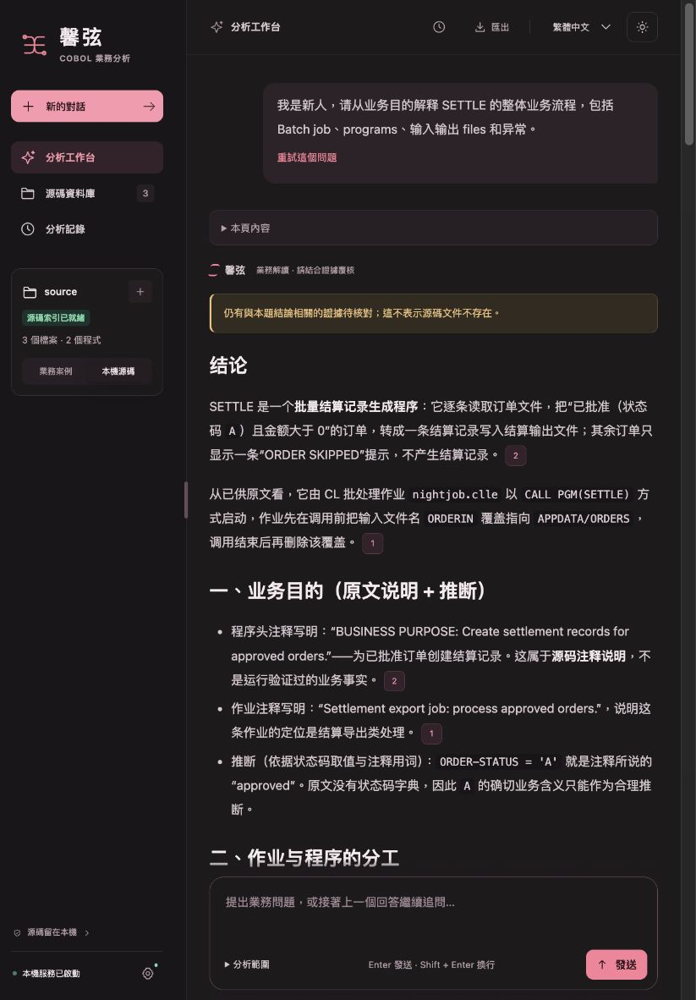
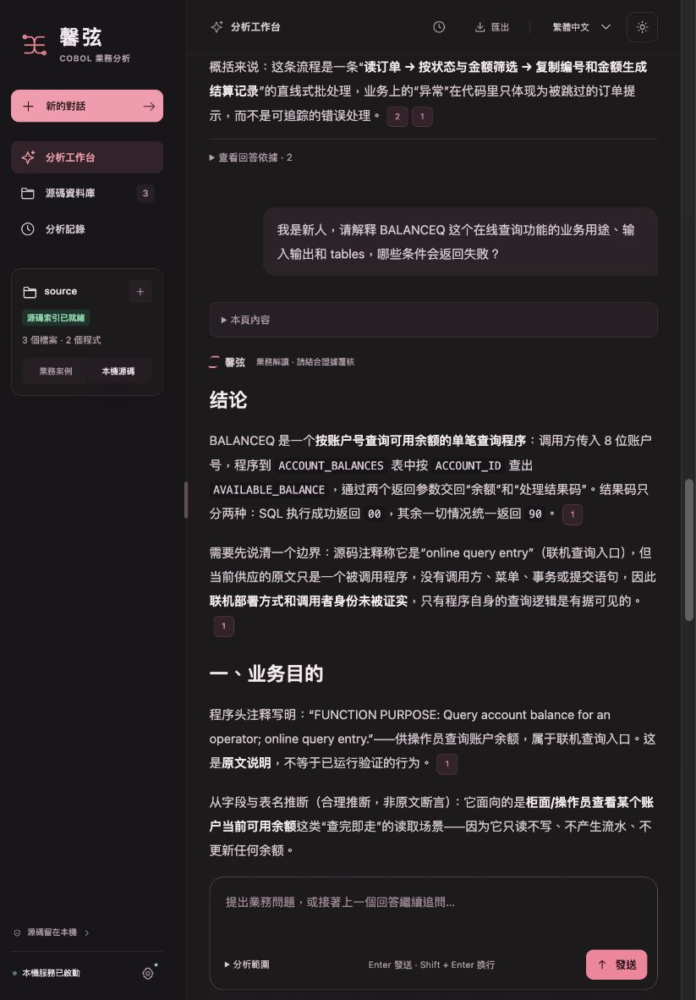
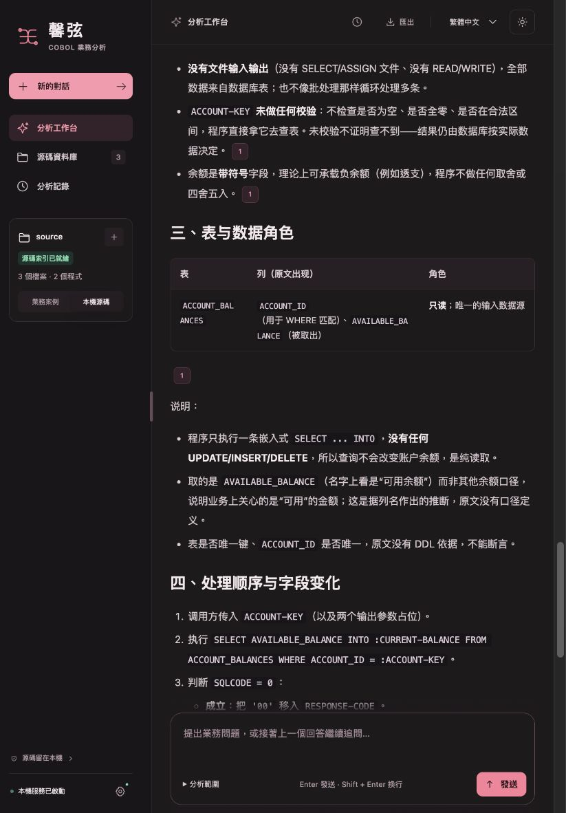
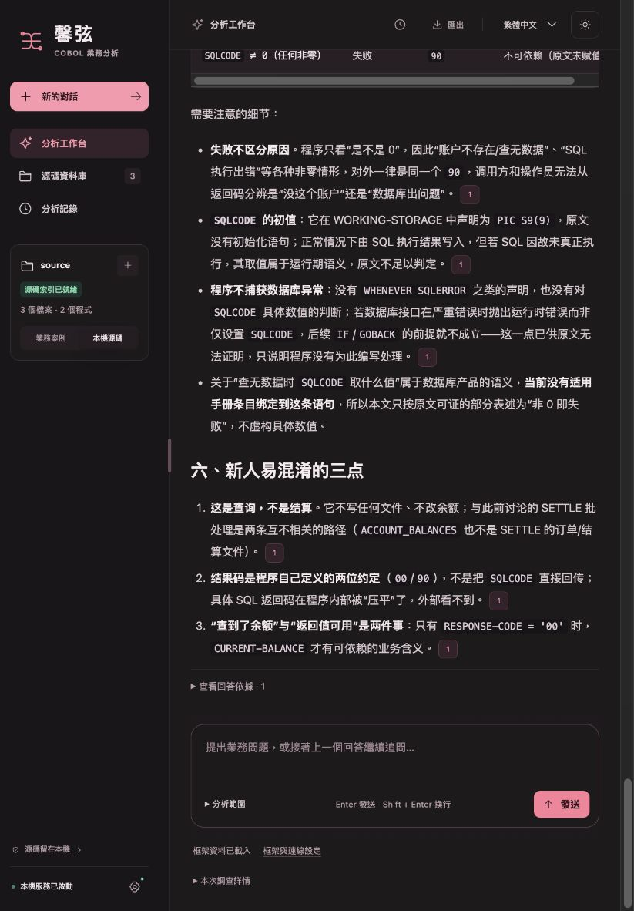
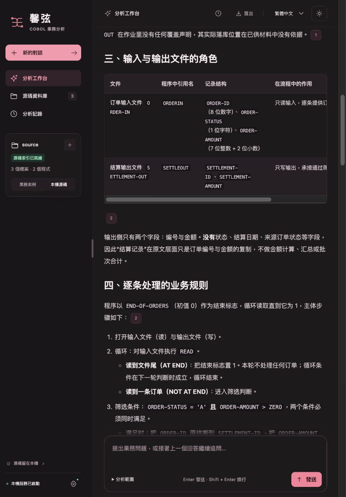
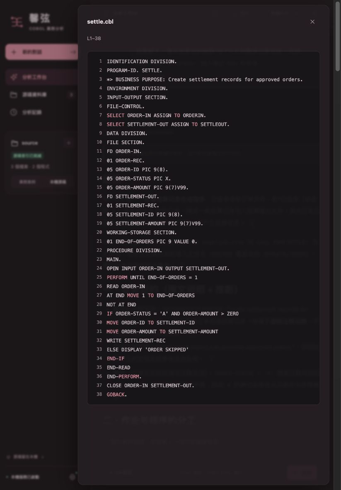

# 业务解释与调查性能修复：真实问答记录

这次修复取消了交互调查默认的 180 秒总截止时间，并让业务概览先取得入口、程序和数据角色，再让模型组织业务解释。索引负责定位与可追溯供证，不负责冒充业务理解或证明模型结论正确。界面布局保持不变。

## 原因与修复

过去会同时遇到几种不同的问题：默认总时限截断调查；已收到的回答被后续检查打断；重复读取没有新证据；升级策略时旧调查身份丢失；有限的文本检查把自然语言结果码 `00` 与源码字符串 `'00'` 误判为矛盾，连带丢掉同句业务解释。此次分别修复这些路径，不以单纯延长时间替代处理。

新调查默认没有总截止时间，但保留 6 次模型请求、5 轮调查、无新证据收敛、单请求传输限制和隐藏输出内容上限。已保存的明确有限策略及旧调查截止时间不被静默清除。未知远程结果不自动重发。隐藏输出按字符计量，不能视为精确 token 或费用上限。

业务概览按“用途 → 有依据的批次/联机入口 → 程序职责 → 表与文件角色 → 业务条件、输入输出和异常”组织。CL 调用与文件覆盖、COBOL 文件读写、SQL 表访问都从实际供应的原文提取；注释用途、语法事实和业务推断保持区别。公式题、简短关系追问不强套这套概览。缺少封闭实现时，解释调用方实际准备了什么、请求什么、怎样处理返回结果，只限定受缺口影响的判断。

## 真实模型结果

下列测试使用三个可公开的中性合成源码文件，不是客户源码，也不能代表大库或办公设备的最终验收。每题都是工作台完整问答路径，均只发出一次实际模型请求。

| 阶段 | 业务题 | 完整问答耗时 | 正文字符数 | 结果 |
|---|---|---:|---:|---|
| 首测 | 批次结算：用途、入口、程序、输入输出文件、异常 | 18.59 秒 | 3375 | 已交付；PARTIAL |
| 首测 | 账户查询：用途、接口、表、失败条件 | 20.84 秒 | 2983 | 已交付 |
| 边界提示修复后 | 同一批次题 | 19.49 秒 | 3539 | 已交付；PARTIAL |
| 边界提示修复后 | 同一查询题 | 25.39 秒 | 3576 | 已交付 |

测试显式使用已确认支持的 `reasoning_effort=low`、8192 输出上限；应用对未配置的接口不强行加入此参数。这里没有同条件随机对照，不能把两次测量宣称为普遍提速比例，也不承诺所有问题都在 30 秒内完成。

原始全文、版本和源码哈希见 [真实问答](real-model-results.json)，逐条复核见 [首测评审](independent-review-initial.json) 与 [复测评审](independent-review-refined.json)。这是代理独立复核，不是人类签字验收。核心业务目的、入口、程序职责、数据角色、主规则和失败分支都已展开；复测仍保留 5 处表述范围或运行前提问题，例如空输入正常退出需要正常 I/O 前提、DISPLAY 的目的地没有运行依据，以及“无可见关联”不能扩大为“两个业务完全无关”。批次题的 PARTIAL 状态原样保留，不能因已有正文而视为全部语义验证通过。

本轮共 4 次实际请求，随后关闭。按响应报告用量、峰值无缓存单价计算，本轮费用上界约 ¥0.178204；加上之前测试累计约 ¥0.643144。所有批次请求前保守预占合计 ¥1.968956，未超过用户 ¥2 限额；这些数值不是服务商账单。详细计算与计量限制见 [费用记录](paid-test-summary.json)。参考服务商的[推理参数说明](https://api-docs.deepseek.com/guides/thinking_mode/)和[价格说明](https://api-docs.deepseek.com/zh-cn/quick_start/pricing/)。

## 实际界面截图

截图来自应用对真实模型保存回答的渲染；展示时使用隔离副本并禁止外部模型请求，没有伪造或改写回答。刷新后两题及引用仍能恢复。[截图哈希](screenshots.json)保留对应关系。

## 源码与 Windows 包验证

本机 3438 项 Python 回归、192 项浏览器回归通过，无失败或跳过；423 个 Python 文件通过 3.10 语法解析。复测时的全部产品文件哈希与最终验证快照一致，见 [离线验证](offline-validation.json)和[运行时独立复核](runtime-independent-review.json)。早期全套曾有 4 项失败，分别暴露自然语言结果码误判与恢复门禁优先级问题，修复后重新跑完整套；未删改旧断言来掩盖失败。

原生 Windows 构建通过手动工作流执行，最终 EXE 必须完成 24 案例、76 样本回归后才生成候选资产；构建与同包报告以 GitHub release 附件为准。这些离线回归和本机两题真实测试，均不能替代最终 Windows ZIP 的真实模型、人工和目标办公设备联合验收。缺项时保留候选，不替换现有正式 Latest。

额外[规模投影测试](orientation-scale-summary.json)保留正负结果：10000 条冗余 CONTINUE 后尾部公式、读写和调用仍在；10000 条 MOVE 的可选业务投影会达到观察项容量边界，部分尾部事实未进入投影，边界明确标记，原始源码没有被删除。这是摘要容量限制，不能宣称投影穷尽全库；首次/重复解析约 4.28/4.29 秒也只覆盖这一局部步骤，不是完整问答耗时。
