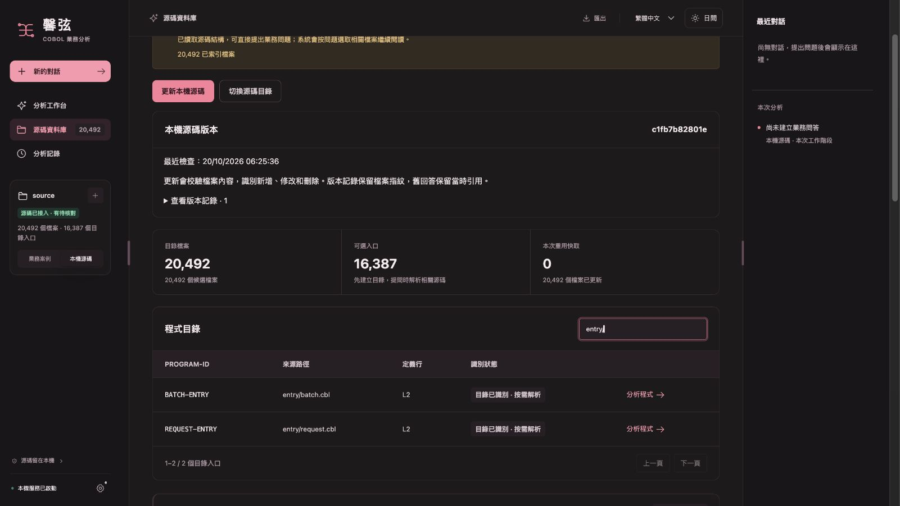
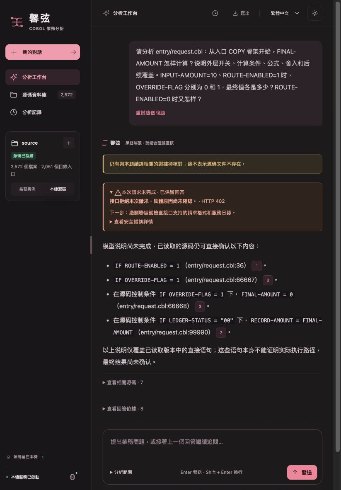
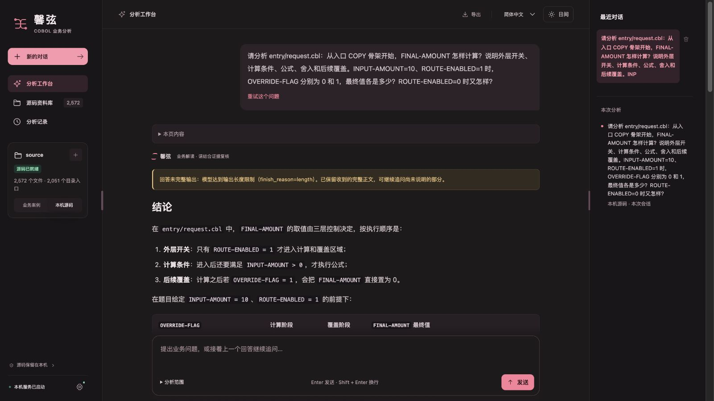
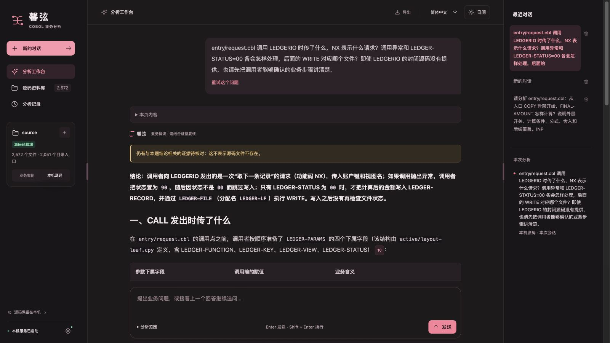

# 大规模源码与框架供证修复

本轮复现的问题是已存在的源码在读取、依赖定位或多轮材料选择时丢失，不能笼统归为“源码未提供”。修复保留实际可见的调用者逻辑，也继续区分封闭运行库的未知行为。界面布局未改。

模拟场景覆盖 MAINB/MAING 类批次与请求入口 COPY、普通嵌套 COPY、独立 COPY REPLACING、同名及重复副本、远距离条件与后续覆盖、LF/PF 的 DDS、参数块和封闭 I/O 调用。公开代码和夹具使用中性名称，没有复制私有框架手册或业务源码。语料采用 UTF-8 自由格式；超长物理行只测试分析器，未在 IBM i 编译或运行，不能据此声称兼容全部框架方言与运行行为。

## 复现与修复

1. 索引页截断超长物理行后，显式范围读取仍只使用截断索引；前部缺行而尾页已到终点时，还误报范围完整。现在针对已定位范围，在原读取额度内核验版本并补读原文；完整性与后续游标按连续物理行计算。额度不足时保留具体缺行，不创建截断引用。
2. 框架事实要求一页覆盖整个 CALL 或参数声明，使相邻两页中的完整原文被忽略。现在按相同路径和版本核对连续行，保留全部引用；缺行、冲突、截断和派生展开不能冒充连续原文。
3. 已唯一定位的 COPY REPLACING 模板被混同为未提供的外部实现。现在用既有调查额度补读其有界原文，区分物理源码存在与替换语义尚未绑定；同名歧义不自动选择，语义关系仍保持候选。
4. 自动续读长段落时，重复语句曾挤掉先前取得的声明、入口和外层条件。现在保留已定位材料，并给真实读取任务中尚未发送的新续读留出机会，避免旧搜索大页占满小额度而阻断修订。新页须实际按同版本、同展开实例、逐行原文送出后才取消待供应优先级，刚完成读取任务的末页也不例外；同一页后来的续读不会抹掉此前的针对性读取身份。未选中的范围仍保留为待查项。
5. 明确询问入口骨架时，旧流程有时只读 `PROCEDURE DIVISION` 一行便认为入口材料已取得。现在仅在入口唯一、已有入口激活补读且没有排他范围时，把这一次读取扩至最多 96 行。入口声明、COPY 和外层开关可一并供应，不新增读取次数，也不把入口识别升级为已证明执行。

默认最多 6 次模型请求、180 秒硬期限、45 秒收尾预留、36,000 普通源码字符和 230,000 请求字节均未增加。读取更多材料与材料已经足够解释某项业务是两个不同判断；不会把整份十几万行文件塞进每个问题。

超长物理行的完整读取是在显式 20,000 字符上限的探针中验证；默认单次读取上限仍为 12,000 字符。较小上限无法容纳整行时，正确结果是标出连续覆盖缺口并保留游标，不能宣称已读完整。

## 压力与供证检查

生成器为 `tools/framework_scale_fixture.py`，独立检查器为 `tools/framework_scale_eval.py`。金标准在写入源码时记录物理行、原文与全文件摘要，不从产品解析结果反推答案。每种入口核对 19 个关键范围；完整性表示本题关键材料实际供应，不能解释为全库原文进入单次请求。

| 规模 | 文件 | 总物理行 | 长入口 |
| --- | ---: | ---: | --- |
| focused | 2,572 | 317,797 | 两份各 100,000 行 |
| stress | 20,492 | 1,242,117 | 两份各 150,000 行 |

原始基线为 `fd9399954a69b1c04b7ad8591f8655f42c261c8b`，在独立源码快照中执行；修复各阶段记录实际产品文件摘要。冷索引、索引复用、实际请求材料与有界工具补读分别计时。默认首包、只发一次三段读取的固定脚本、按当前缺口继续读取的闭包脚本分别记录。脚本给出的读取位置来自金标准，因此这些结果验证工具链与材料保留，不证明模型自主发现能力或业务回答正确率。

较大语料的旧版批次闭包曾出现 `16 → 19 → 19 → 12 → 17 → 16`：历史累计读齐，不代表最后一次请求仍有完整原文。当前页、实际携带的原文记忆、历史累计覆盖分别统计，候选草稿不当作源码。阶段结果和最终统计见本目录的测量文件。

最终冻结代码在两档语料的请求与批次问题中均达到 `17 → 19 → 19 → 19`，覆盖没有在后续请求丢失；原固定读取脚本与按缺口补读脚本均如此。冷建业务及搜索索引分别为 **12.33 / 55.85 秒**，复用搜索索引检查为 **0.284 / 2.272 秒**；按缺口补读脚本的首请求准备两档均约 **3.18–3.19 秒**。这些为本次 Mac 测量，假接口没有真实模型等待，单次冷测也不能用来承诺普遍提速。各轮实际请求大小、范围、耗时、内存、预算及版本摘要见 [最终完整统计](scale-results-final-v3.json)；[上一阶段统计](scale-results.json) 保留，不替换为新版本结果。

独立只读审计逐个核对了全部文件及 **3,264 / 21,528 个索引页**：文件摘要和物理行数匹配，范围元数据覆盖全部 **317,797 / 1,242,117 行**，首中尾缺口与重叠均为 0。完整页文本各少 **1 行**：唯一 13KB 超长行探针明确保存为 12KB 前缀并标记截断，不能算完整源码证据；其余 **3,263 / 21,527 页**与原文逐字一致。显式范围工具在足够额度内取得这条完整原文，小额度下则正确保留缺口。审计器为 `tools/audit_framework_scale_pages.py`，11 条金标准与审计测试包含伪造、缺行和截断负例。

## 真实工作台与首次模型阻断

最终代码另在全新本地工作台实际导入较大语料：**20,492 文件用时 54.90 秒**，全部作为新文件处理，没有复用旧导入缓存或发送模型请求。[最终导入记录](final-v3-ui-import.json) 绑定实际代码摘要和源码快照；续读回退修复前的 [54.96 秒记录](final-ui-import.json) 另行保留。

真实 Mac 源码工作台导入 focused 语料用时 **12.51 秒**。四个问题及源码预期在模型调用前冻结，见 [题集](real-questions.json)。首题在 **3.145 秒**发出模型请求，接口约 **1.451 秒**后返回 HTTP 402，完整任务约 **4.90 秒**。没有收到模型答案，不能报告回答正确或真实模型提速；其余三题没有继续发送。[原始记录](real-q1-http402.json) 与 [请求供证追踪](real-q1-wire-trace.json) 保留失败、供证范围与摘要及当时代码摘要，不含完整请求正文，不追记成后续最终代码的真测。

该次原始中性手册还存在四字符占位与六字符源码前缀不匹配的问题，公式题不依赖这条 I/O 约定；原件保留为 [旧手册](original-synthetic-reference.md)。后续离线压力验证使用 [修正手册](synthetic-reference.md)，语料源码所有路径与字节相同。没有原地改写已经测试的输入。

模型不可用时的本地事实说明只证明实际展示了读取到的语句，不能代替完整业务解释。普通嵌套布局的部分框架绑定仍有限：源码可明确说明传入 NX、KEY、VIEW 和状态分支，手册可说明请求约定，均不证明封闭实现实际返回哪条记录、锁状态、成功写入或事务提交。

## 额度恢复后的有限真实复测

用户恢复额度后，明确要求本轮控制在人民币 2 元以内。测试仍使用提交 `e35dbd2693740da2357cb31a81556680bfc96936`，仅发送上述中性 focused-v2 源码与修正手册，按冻结题集执行 q1、q3 各一次；没有重刷失败题、切换接口或发送封闭实现。临时发包拦截按高峰、输入无缓存优惠及完整输出上限预占费用，整批限制 1.70 元和 8 次实际请求，失败不退预占，重启不清账。拦截器 14 项纯离线检查通过。两题结束后，验收工作台已禁用后续模型网络调用。

实际共 **4 次模型请求**，预占合计 **1.226752 元**；四次均返回完整用量，按[官方人民币高峰价格](https://api-docs.deepseek.com/zh-cn/quick_start/pricing/)且完全不计算缓存优惠，费用上界为 **0.464940 元**。预占与用量估算均不冒充供应商账单；账户余额不进入公开记录。[两题原始模型正文、实际显示正文与用量](bounded-live-results.json) · [独立逐项复核](bounded-live-review.json)

| 问题 | 工作台耗时 | 真实结果 |
| --- | ---: | --- |
| q1：计算、外层条件与后续覆盖 | 82.60 秒 | 算出 37.00 / 0.00，但答案截断，附加了无源码依据的默认初始化推断；本地校验还误改了正确公式及不执行分支。未通过。 |
| q3：封闭框架调用与写出 | 63.91 秒 | 能说明参数、NX 请求、异常 90、状态 00、MOVE→WRITE 及文件映射；正文完整，但遗漏 CALL/WRITE 位于外层条件之外、未见 OPEN 及提交结果不可确认等边界。未通过完整性验收。 |

这次把“模型看不到源码”和“看到源码后仍答不好”分开了：q1 两轮实际供应的 10 页、397 行与原文件逐字及摘要核对一致，包含入口、声明、替换模板、公式和覆盖。正确的跨行 COMPUTE 在无程序头 COPY 片段中漏过本地事实投影，核验器拿同目标的后续 MOVE 0 当成反证；业务问题中的 `ROUTE=0` 不执行路径也被误判为“源码写着 IF=0”，造成三处本地误改。这些是系统缺陷，不能归咎源码未提供。q3 供应的 11 页、414 行也通过原文核对，但没有供应全部替换模板、PF 定义和手册边界段，不能宣传完整运行语义已获证明。

两题第一轮均耗尽 8,192 个生成 token 而没有正文，随后各进行一次既有恢复请求。q1 的 82.34 秒中模型等待 79.10 秒、本地处理 3.24 秒；q3 的 63.68 秒中分别为 59.89 / 3.80 秒。因此本次实际问答时延主要发生在模型侧，不能拿约 3 秒的材料准备时间宣传整体提速。以下离线修复只回放保存的结果，不追加付费请求，也不将回放结果当成新版本真实模型验收。

## 真实复测后发现的核验缺陷修复

本次后续修复只使用保存的模型正文和当时实际供应的 10 页源码，逐页复核原文件与节录摘要后重放。无程序头 COPY 中有明确结束边界的完整跨行 COMPUTE 现在可核对语法；后续 MOVE 不再作为另一条显式 COMPUTE 的反证。输入假设、不执行路径保持为未形式验证的业务场景，真正断言源码条件的句子仍核对 IF；后一句的“不执行”不会掩盖前一句错误的正向条件。页末未读到 END-COMPUTE 或句点时仍不采信为完整公式。

最终回放保留 q1 原模型正文中的正确公式和两处不执行分支，误改从三处降为零；显示层只去掉末尾 30 字符的半引用，不补造引用或正文。原始诊断、两次请求、输出截断和 PARTIAL 状态均保留。q3 回放正文逐字不变。模型关于首次运行初始化为零的额外推断仍属未证实，不能因为这次修复就视为正确答案。[离线回放与逐项检查](bounded-live-offline-replay.json)

针对性回归 214 项通过，独立复核另验证了正向错误条件、真实假设分支和不完整页尾等边界；这两题未重新请求模型。最终全量源代码回归 **3,339 项全部通过、无跳过**，用时 **178.77 秒**；页面回归 **190 项通过**，408 个 Python 文件通过 3.10 语法解析，见 [后续验证记录](bounded-live-offline-validation.json)。本次改变处理流水线版本，保留原提示词和模型设置，不能用离线回放推断真实问答提速。

## 最终程序与发布边界

真实复测前的候选提交 `e35dbd2693740da2357cb31a81556680bfc96936`，本地完整回归 **3,322 项全部通过，无跳过**；页面回归 **190 项通过**，407 个 Python 文件通过 3.10 语法解析。测试源码与产品文件摘要见 [原验证记录](local-validation.json)。此前完整回归发现两条既有测试的六个子失败：旧搜索大页挤掉了小额度的新续读，使修订未发出。本轮修复保留原断言，补齐真实任务的待供应状态后重新运行完整回归；没有用修改预期或扩大预算消除失败。后续核验修复的代码摘要与完整回归单独记录，不覆盖旧测试结果。

Windows 离线合同保留原 67 样本，新增跨页框架调用 3 次，共 22 案例、70 样本。新场景通过真实桌面 HTTP 路径读取 CALL 与 COPY 原文，并要求实际请求中必须由多页连续覆盖调用；还检查引用、脚本正文保留及运行效果仍未知。合成接口测试不代表真实模型质量。

最终 Windows 结果以对应候选包的 `COMPILED-ACCEPTANCE.json`、`BUILD-INFO.json`、校验和及 GitHub 构建记录为准，本报告不预记构建通过。目标 Windows 设备和同包真实模型人工验收仍缺，因此仅发布候选，不替换正式 Latest。Mac 开发源码将在候选发布前与 GitHub 主分支同步，最终版本与来源在候选发布说明中标明。
